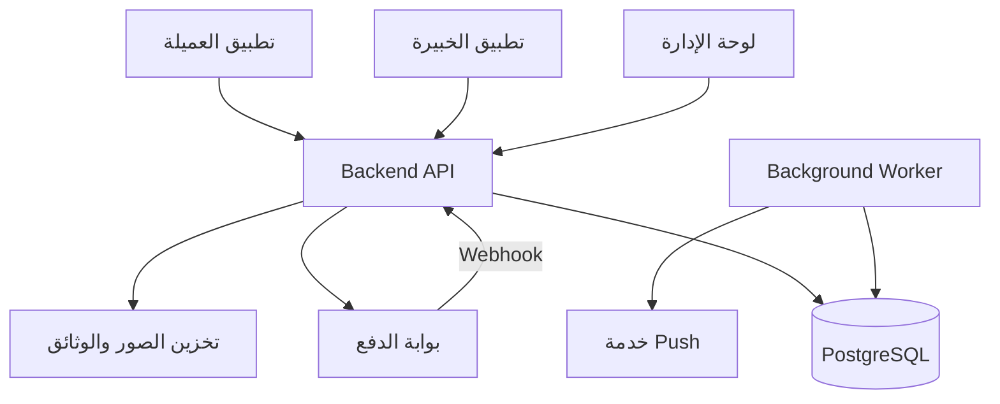

# لمسة — Product Overview & Master Implementation Roadmap

مرجع البداية لـCodex لفهم المنتج ومكوناته وحدود الـMVP وترتيب التنفيذ.

التاريخ: 2026-10-09

## 1. اقرأ هذا أولًا

**لمسة** منصة تربط العميلة بخبيرة تجميل: تستعرض العميلة الخدمات والخبيرات، تختار موعدًا وعنوانًا، ترسل طلب حجز، تقبله الخبيرة، ثم تدفع العميلة لتأكيده، وبعد تنفيذ الخدمة يُستكمل الحجز ويصبح التقييم متاحًا وتُحسب مستحقات الخبيرة وفق السياسة المعتمدة.

المنظومة تتكون من:

1. تطبيق العميلة باستخدام Flutter.
2. تطبيق الخبيرة باستخدام Flutter.
3. Backend API مشترك باستخدام Node.js وTypeScript وExpress.
4. قاعدة PostgreSQL مع Drizzle وmigrations.
5. Admin Dashboard لإدارة التشغيل.
6. مهام خلفية وتكاملات الدفع والإشعارات وتخزين الصور.

**الهدف مزدوج:** إطلاق MVP قابل للتجربة والتطوير، وإنتاج مشروع Backend Portfolio يبرهن على فهم المعاملات والتزامن والصلاحيات والمدفوعات والاختبارات.

**تصحيح من صاحب المشروع بعد فحص البداية: قاعدة البيانات لم تُنفذ بعد، والموجود وثيقة التصميم فقط.** المطلوب تنفيذ schema وmigrations وفق القرارات المعتمدة بعد حسم السياسات المؤثرة. لا تعتبر بقية المكونات مكتملة دون دليل؛ الحالة الفعلية مسجلة في `PROJECT_STATUS.md`.

## 2. كيفية استخدام الوثائق

| الملف | مسؤوليته |
| --- | --- |
| `ROADMAP_README.md` | فكرة المنتج، الرحلات، المكونات، وخطة التنفيذ المتكاملة |
| `README.md` بعنوان «لمسة — قرارات تصميم قاعدة البيانات» | قرارات الجداول والعلاقات والحالات واللقطات والقيود |
| `BACKEND_README.md` | خطة الخادم والوحدات والصلاحيات والحجز والدفع والاختبارات |
| `DASHBOARD_README.md` | صفحات لوحة الإدارة وصلاحياتها وتكاملها مع API |
| `AGENTS.md` إن وجد | تعليمات العمل المنطبقة على المستودع أو مجلداته |
| الـschema والـmigrations وOpenAPI والاختبارات | أدلة التنفيذ الفعلي وعقود التكامل |

ضع الوثائق في جذر المستودع أو مجلد توثيق واضح. إذا كان للمستودع README تشغيلي بالفعل، لا تستبدله؛ احتفظ بوثيقة الداتابيس باسم أو مسار موضح في فهرس الوثائق.

هذا الملف يربط الخطط المتخصصة ولا يغيّر قراراتها بصمت. عند التعارض، حدّد موضعه وأثره، وارجع إلى أحدث قرار صريح للمستخدم. ميّز بين «معتمد»، و«مقترح»، و«يحتاج حسمًا». أكمل العمل غير المتأثر دون تعطيل المشروع بأسئلة عن اختيارات تنفيذية روتينية.

## 3. الفكرة والنطاق التجاري

### المشكلة التي يحلها المنتج

تحتاج العميلة إلى معرفة الخدمات والأسعار والخبرات والتوفر، وحجز موعد موثوق، ومتابعة حالة الطلب والدفع. وتحتاج الخبيرة إلى إدارة خدماتها وتوفرها وطلبات العمل ومستحقاتها. وتحتاج الإدارة إلى اعتماد الخبيرات ومتابعة التشغيل والمال من مصدر بيانات واحد.

### حدود الإطلاق

- القرار الحالي للمستخدم: الإطلاق في **القاهرة، مصر** بعملة `EGP` وتوقيت أعمال `Africa/Cairo` بدل التصور السعودي السابق. لا تُحوَّل العملات التاريخية تلقائيًا.
- الإطلاق في القاهرة فقط؛ أي مدن مرجعية قديمة لا تعني تشغيلها ضمن السوق الجديد.
- الحجز لخدمة واحدة لدى خبيرة واحدة وفي موعد محدد.
- السعر خاص بالخبيرة والخدمة، لكن مدة الخدمة موحدة على مستوى `services` في الـMVP.
- يتضمن الحجز عنوان العميلة ولقطته؛ الرحلة الموصوفة هنا تفترض تقديم الخدمة في العنوان المحدد. أي نموذج إضافي للخدمة في صالون يحتاج قرار نطاق منفصل.
- تختار العميلة الخبيرة بنفسها؛ توزيع الطلب تلقائيًا على خبيرات متعددات ليس ضمن الخطة.
- العمولة الافتراضية المعتمدة **20%**، قابلة للتغيير عبر الإدارة، مع حفظ النسبة والمبالغ المطبقة لكل حجز. هذه نسبة عمولة وليست ضريبة.
- نموذج الضريبة ورسوم الانتقال والإلغاء والاسترجاع لا تُخترع أثناء التنفيذ.

## 4. المستخدمون والصلاحيات

| الطرف | ما يفعله | حدود مهمة |
| --- | --- | --- |
| العميلة `customer` | إدارة حسابها وعناوينها، الاستعراض والحجز والدفع والتقييم | تصل إلى بياناتها وحجوزاتها فقط، ولا تحدد السعر أو العمولة من التطبيق |
| الخبيرة `expert` | إدارة ملفها وخدماتها وأسعارها وتوفرها وطلبات الحجز ومستحقاتها | لا تعتمد نفسها ولا تصل إلى حجوزات خبيرة أخرى |
| المدير `admin` | اعتماد الخبيرات وإدارة البيانات ومتابعة التشغيل والمال | لا يتجاوز State Machine أو يسجل دفعًا ناجحًا اعتباطيًا |
| النظام | تطبيق المهل والتحقق من أحداث الدفع وإرسال الإشعارات | كل حدث آلي يخضع للتحقق ومنع التكرار ويسجل أثره المناسب |

نموذج الأدوار المرجعي يحتوي دورًا واحدًا في `users.role`. تبديل الحساب بين دور العميلة والخبيرة أو الجمع بينهما لم يُعتمد؛ لا تفترضه في التطبيق.

## 5. رحلة العميلة وشاشاتها

### الرحلة الرئيسية

1. تدخل برقم الهاتف وكلمة مرور؛ التسجيل لأول مرة يمر بخطوة OTP. اعتمد المستخدم مؤقتًا للعرض الرمز الثابت `123456` دون SMS؛ التحقق الحقيقي من ملكية الهاتف ينتظر ربط مزود لاحقًا.
2. تستعرض الخدمات والخبيرات المتاحات في مدينة الإطلاق.
3. تفتح ملف خبيرة وتراجع خدماتها وأسعارها وأعمالها وتقييماتها.
4. تختار خدمة وموعدًا من Slots يوفّرها الخادم.
5. تختار عنوانًا محفوظًا أو تضيف عنوانًا، ثم تراجع ملخص الطلب.
6. ترسل الحجز وتراه `pending` بانتظار قرار الخبيرة.
7. إذا قُبل، يصبح `accepted` وتظهر إمكانية الدفع ووقت المهلة إذا كان محددًا.
8. تدفع عبر المسار المعتمد. التطبيق يعرض نتيجة الخادم؛ الرجوع من بوابة الدفع وحده لا يؤكد الحجز.
9. يصبح الحجز `confirmed` بعد تحقق الدفع، ثم `completed` عند الإكمال وفق الصلاحية المتفق عليها.
10. تكتب تقييمًا، وتستطيع الرجوع إلى تفاصيل الحجز وسجل حالته لاحقًا.

### الشاشات المطلوبة

| الشاشة | محتواها ووظيفتها |
| --- | --- |
| الدخول والحساب | تسجيل ودخول، معالجة انتهاء الجلسة، والوسائل المقررة لاستعادة الوصول |
| الرئيسية | الخدمات وخبيرات متاحات دون عروض أو أقسام غير مدعومة |
| قائمة الخبيرات | فلترة بالخدمة والمدينة المتاحة، مع pagination وحالات الفراغ |
| ملف الخبيرة | التعريف والخدمات والأسعار والمدة والمعرض والتقييمات |
| اختيار الموعد | المواعيد المتاحة للخدمة ومعلومات المنطقة الزمنية |
| العناوين | إضافة وتعديل واختيار العنوان الافتراضي |
| مراجعة الحجز | الخدمة والخبيرة والوقت والعنوان والمبلغ كما يحدده الخادم |
| حجوزاتي | القادمة والسابقة أو فلترة بالحالة دون فقد الحالات المنتهية |
| تفاصيل الحجز | الحالة والمهلة والأطراف والمبالغ وسجل التغييرات والإجراءات المسموحة |
| الدفع ونتيجته | بدء الدفع وانتظار التحقق وعرض النجاح أو الفشل من المصدر الموثوق |
| التقييم | الدرجة والتعليق بعد اكتمال الحجز فقط |
| الإشعارات | تنبيهات الحساب وروابط تفاصيل الحجز المصرح بها |
| الملف الشخصي | بيانات الحساب والإعدادات الأساسية والخروج |

التصفح دون حساب قبل الحجز، وطريقة استعادة الوصول، والتصميم النهائي للتنقل اختيارات تحتاج مواءمة مع العقد والواجهات الموجودة؛ لا تفترض OTP أو دخولًا اجتماعيًا أو شراء كضيف.

### الحالات البديلة الواجب دعمها

- لا توجد خبيرات أو مواعيد، أو لم تعد الخدمة متاحة.
- اختير موعد ثم حجزته عميلة أخرى قبل الإرسال أو القبول: تحديث المواعيد برسالة مفهومة.
- رفض الطلب أو انتهاء المهلة أو الإلغاء وفق السياسة.
- فشل الدفع أو انقطاع الاتصال أو انتظار تأكيد العملية.
- تغيّر عنوان محفوظ لاحقًا: لا يغيّر عنوان الحجز السابق.
- إغلاق التطبيق ثم فتحه: تُستعاد حالة الحجز من API ولا تعتمد على آخر حالة محلية.

## 6. رحلة الخبيرة وشاشاتها

### الرحلة الرئيسية

1. تنشئ حساب خبيرة وتكمل الملف والمعلومات المطلوبة للاعتماد.
2. تختار الخدمات التي تقدمها وتحدد أسعارها وتضيف معرض أعمالها.
3. تضيف الجدول الأسبوعي واستثناءات الإجازات أو التوفر الإضافي.
4. تراجع الإدارة ملفها وتغيّر حالة اعتماده وفق السياسة.
5. بعد استيفاء شروط الاعتماد والنشاط والتوفر، تظهر للعميلات وتستقبل طلبات تخصها.
6. تقبل الحجز أو ترفضه؛ القبول لا يعني أن الدفع تم.
7. تتلقى تأكيد الحجز بعد الدفع وتطّلع على معلومات تنفيذ الخدمة المسموح بها.
8. تُستكمل الخدمة والحجز وفق صلاحيات الإكمال المتفق عليها، ثم يمكن التقييم المتبادل.
9. تتابع مستحقاتها والتحويلات، مع فصل المؤهل للصرف عن المصروف بالفعل.

### الشاشات المطلوبة

| الشاشة | محتواها ووظيفتها |
| --- | --- |
| الدخول واستكمال الملف | بيانات الخبيرة ومتطلبات الاعتماد |
| حالة الاعتماد | `pending` أو `approved` أو `suspended` وفق API |
| ملخص الخبيرة | طلبات تنتظر القرار وحجوزات قادمة دون أرباح تقديرية مضللة |
| ملفي وخدماتي | النبذة والخدمات والأسعار والمعرض |
| التوفر الأسبوعي | أيام وفترات العمل |
| استثناءات التوفر | إجازة أو توفر إضافي في تاريخ محدد |
| الطلبات والحجوزات | قائمة وفلاتر وتفاصيل وقبول أو رفض عند السماح |
| تفاصيل الحجز | الخدمة والوقت وحالة الدفع والعنوان في حدود صلاحية الوصول |
| المستحقات والتحويلات | المبالغ التي يعيدها الخادم وتفاصيل الصرف |
| التقييم والإشعارات | التقييم المتبادل والتنبيهات وروابط الحجز |
| الحساب | بيانات الحساب والخروج وإعدادات متاحة |

اعتماد الملف، وحظر الحساب، وإيقاف استقبال الحجوزات مفاهيم مستقلة. لا تضف حالة رفض اعتماد جديدة دون قرار. اعتمد المستخدم إظهار العنوان الكامل دائمًا للخبيرة صاحبة الحجز؛ لا يعني ذلك الوصول لعناوين عميلات خارج حجوزاتها.

## 7. دور لوحة الإدارة

الـDashboard يخدم التشغيل منذ بداية المشروع: لا تؤجل كل شاشاته إلى ما بعد التطبيقات.

الحد الأدنى المبكر: دخول المدير، إدارة الخدمات، مراجعة واعتماد الخبيرات، ومتابعة الحجوزات وتاريخ حالاتها. بعد جاهزية الدفع تُضاف المدفوعات والاسترجاعات والمستحقات، ثم الملخص والإعدادات والتقييمات.

راجع `DASHBOARD_README.md` للتفصيل. تقنية React/TypeScript/Vite/MUI مقترحة للوحة جديدة وليست قرارًا لإعادة كتابة لوحة موجودة. تغيير حالة مالية أو إلغاء حجز يجب أن يمر عبر API ينفذ القاعدة التجارية ويسجل النتيجة.

## 8. المكونات التقنية وحدود المسؤولية



الخادم والـWorker يمكن أن يكونا عمليتين من المشروع نفسه؛ لا يعني الرسم Microservices. تخزين مهام الإرسال وكيفية استلام الـWorker لها يُحددان في التصميم التنفيذي.

| المكون | مسؤوليته | لا يفعل |
| --- | --- | --- |
| Flutter Apps | العرض والتفاعل وإدارة الجلسة وطلب البيانات | لا يحتسب السعر النهائي ولا يؤكد دفعًا ذاتيًا |
| Dashboard | إدارة العمليات عبر صلاحيات واضحة | لا يتصل مباشرة بالداتابيس ولا يملك أسرار المزود |
| API | المصادقة وقواعد الأعمال والعقود والمعاملات | لا يعتمد على إخفاء زر في الواجهة كوسيلة صلاحية |
| PostgreSQL | الحفظ والقيود والعلاقات ومنع التداخل | لا يغيّر حالات الحجوزات تلقائيًا لمجرد مرور الوقت |
| Worker | انتهاء المهل وإعادة محاولات الإشعارات وغيرها من المهام المعتمدة | لا يعتمد على تشغيل التطبيق في الخلفية لدى المستخدم |
| بوابة الدفع | تنفيذ العمليات المالية الخارجية وإشعاراتها | لا تُعتبر متزامنة ذريًا مع معاملة PostgreSQL |
| التخزين | حفظ الصور والوثائق بصلاحيات وصول مناسبة | لا يجعل وثائق الهوية ملفات عامة |

### بنية Backend

Modular Monolith بوحدات `auth`, `users`, `addresses`, `experts`, `services`, `availability`, `bookings`, `payments`, `reviews`, `payouts`, `notifications`.

المسار الداخلي: Route والتحقق من الطلب، ثم Controller صغير، ثم Service لقواعد العمل والمعاملة، ثم Repository للاستعلامات. تستخدم جميع العمليات المشاركة اتصال المعاملة نفسه.

### بنية تطبيقات Flutter المقترحة

تنظيم حسب Feature، مع فصل واجهة العرض وإدارة حالتها عن Repository وAPI client وDTOs. حافظ على النمط الموجود إن كان مناسبًا. لا تفرض BLoC أو Riverpod أو مكتبة HTTP جديدة دون فحص المشروع؛ اختيارها تنفيذي ولم يُحسم بعد.

تجربتا العميلة والخبيرة مطلوبتان. الخيار المقترح لمشروع جديد هو تطبيقان منفصلان يشتركان في مكونات مناسبة؛ فصل الحزم أو استخدام تطبيق واحد متعدد الأدوار يحتاج تثبيتًا قبل إعداد البنية، خصوصًا أن الجمع بين دورين في الحساب لم يُعتمد.

مشاركة الثيم وعقود البيانات ومكونات العرض ممكنة، لكن لا تنقل قواعد التسعير والصلاحيات النهائية من الخادم إلى حزمة Flutter مشتركة.

### تنظيم المستودع المقترح

يمكن البدء بمستودع يجمع `backend/`, `dashboard/`, `apps/customer/`, `apps/expert/`, `docs/`. هذا تنظيم اختياري؛ لا تنقل مشاريع قائمة أو تفرض Monorepo أو مشاركة كود بين Node وDart لمجرد مطابقة هذه الوثيقة.

## 9. نموذج البيانات والقرارات الثابتة

التصميم المرجعي يحتوي **17 جدولًا تجاريًا**، وليس 16. راجع المخطط المنفّذ ولا تستخدم العدد كسبب لإزالة جداول تقنية لازمة.

| المجال | الجداول المرجعية |
| --- | --- |
| مرجعية وإعدادات | `cities`, `services`, `settings` |
| الحسابات والعناوين | `users`, `expert_profiles`, `customer_addresses` |
| عرض الخبيرة وتوفرها | `expert_services`, `expert_availability`, `expert_availability_exceptions`, `portfolio_images` |
| الحجز والدفع | `bookings`, `booking_status_history`, `payments`, `payouts` |
| التقييم والإشعارات | `reviews`, `notifications`, `device_tokens` |

- PostgreSQL هو مصدر الحقيقة؛ لا تستمر ملفات JSON كقاعدة تشغيل بعد اكتمال الترحيل.
- تغييرات القاعدة عبر migrations. المخطط المنفذ وDrizzle وSQL المرجعي لا تتطور كنسخ مستقلة متعارضة.
- المال بنوع عشري دقيق، مع توحيد وحدة النسب وسياسة التقريب وصيغة الأموال في API.
- الوقت يحفظ كـ`timestamptz` للأحداث، ويُعرض ويُفسر جدول العمل وفق `Africa/Cairo` مع مراعاة التوقيت الصيفي.
- العنوان والسعر والعمولة والضريبة ومدى الحجز تُحفظ لقطات لا تتغير بتعديل بياناتها المرجعية.
- الحسابات ذات السجلات التاريخية تُعطّل وفق السياسة بدل حذف تاريخها المالي.
- الجلسات وأحداث الدفع وOutbox قد تحتاج جداول تقنية إضافية؛ تُصمَّم عند الحاجة وتُوثَّق، ولا تعتبر معتمدة تلقائيًا لمجرد ذكرها.

## 10. الحجز والدفع والتزامن

### حالات الحجز

| الحالة | المعنى |
| --- | --- |
| `pending` | ينتظر قرار الخبيرة |
| `accepted` | قُبل وينتظر الدفع |
| `confirmed` | حجز مؤكد بعد تحقق الدفع |
| `completed` | اكتملت الخدمة والحجز وفق السياسة |
| `rejected` | رفضت الخبيرة الطلب |
| `cancelled` | أُلغي وفق الصلاحيات والسياسة |
| `expired` | انتهت المهلة المقررة |

المسار الأساسي: `pending → accepted → confirmed → completed`.

حالات الدفع منفصلة: `pending`, `paid`, `failed`, `refunded`. لا تضف `paid` إلى حالات الحجز. لا تدخل `on_the_way` أو `in_progress` ضمن الـMVP. التأكيد بعد الدفع لا يحدد وحده سياسة التعامل مع استرجاع أو إلغاء لاحق؛ هذه السياسة تحتاج اعتمادًا.

### مثال تنفيذي مختصر

ترسل العميلة `expertId`, `serviceId`, `addressId`, `startsAt` وملاحظات اختيارية. يأخذ الخادم هوية العميلة من الجلسة، ويتحقق من ملكية العنوان واعتماد الخبيرة والخدمة والتوفر، ويحسب السعر والمدة والمبالغ من مصادره، ثم يحفظ الحجز وسجله معًا.

إذا كان موعد متاحًا وقت العرض ثم شغله طلب آخر، يحسم قيد PostgreSQL التعارض. لا تكفي عبارة «فحصنا التوفر قبل الحفظ». حُسم بدء حجز الفترة عند `accepted` مع السماح بتداخل `pending`؛ قيد الاستبعاد المنفذ يشمل `accepted`, `confirmed`, `completed`. محرك القبول والمهل لم يُنفذ بعد.

عند الدفع، يبدأ الخادم العملية بالمبلغ والعملة الموثقين، ويتحقق من النتيجة عبر البوابة، ثم يحدّث سجل الدفع والحجز المؤهل وسجل الحالة في معاملة محلية واحدة. وصول نفس Webhook عدة مرات لا يكرر الأثر. نجاح متأخر بعد انتهاء الحجز يُعالج بسياسة صريحة ولا يعيد تأكيد موعد أصبح مشغولًا.

فشل Push بعد نجاح الحفظ لا يعني فشل الحجز. تُستخدم آلية إرسال دائم قابلة لإعادة المحاولة وفق التصميم التنفيذي.

## 11. الإعدادات التي لم تُحسم بعد

لا توقف كل المشروع بسبب هذه القائمة. افحص ما حُسم في الكود والوثائق، ثم احسم كل قرار قبل المرحلة التي تعتمد عليه.

| القرار | يؤثر على |
| --- | --- |
| حُسم: القاهرة وEGP وAfrica/Cairo؛ الخدمة في عنوان العميلة ضمن مدينة الإطلاق | الكتالوج والحجز |
| حُسم: هاتف وكلمة مرور مع OTP للتسجيل؛ مزود SMS واستعادة الوصول ما زالا مفتوحين | الحسابات والتطبيقات |
| فصل التطبيقين وطريقة توزيع الحزم | إعداد Flutter والبنية |
| حُسم: `pending` لا يشغل الموعد؛ يبدأ الحجز المؤقت عند `accepted`، ولا يقبل طلبان متداخلان | التوفر وقيد التداخل؛ مدة المهلة ما زالت مفتوحة |
| حُسم: 10 دقائق لقبول الطلب و10 دقائق للدفع، قابلتان للتعديل من الإدارة | واجهات الحالة والـWorker؛ الإعدادات منفذة، والمحرك متبقٍ |
| الطرفان يستطيعان الإلغاء والإكمال؛ الحالات والتوقيت والأثر المالي ما زالت تحتاج تحديدًا | State Machine والواجهات |
| حُسم: نهار فقط؛ ساعات النهار ومدة الانتقال وأولوية الاستثناءات لم تُحدد | حساب Slots |
| سياسة اختلاف السعر بين العرض وإرسال الطلب ووقت تثبيت اللقطة | ملخص الحجز وتجربة التأكيد |
| حُسمت العمولة الافتراضية 20% القابلة للتعديل؛ الضريبة والتقريب والرسوم ما زالت مفتوحة | المبالغ والدفع والمستحقات |
| حُسم: دفع Demo قابل للاستبدال لاحقًا؛ الاسترجاع والنجاح المتأخر ما زالا مفتوحين | الدفع والتأكيد |
| حُسم: إظهار العنوان الكامل دائمًا للخبيرة صاحبة الحجز | الخصوصية وتفاصيل الحجز |
| أهلية الصرف والاسترجاع بعد التحويل | المستحقات |
| مزود Push والتخزين والاستضافة | التكامل والنشر |

وجود `vat_rate` و`vat_amount` لا يبرر فرض نسبة أو وعاء ضريبي. ووجود `refunded_amount` لا يعني اعتماد الاسترجاع الجزئي؛ يُضاف فقط عند دعم البوابة وحاجة المنتج.

## 12. خطة التنفيذ المتكاملة

نفّذ **رحلات مكتملة** بدل إنهاء كل Backend ثم البدء في جميع الواجهات. يمكن تصميم الواجهة ببيانات تجريبية معلّمة أثناء تجهيز API، لكن لا تعتبرها مربوطة حتى تُختبر مع الخادم الحقيقي.

### R0 — فحص المشروع وتثبيت نقطة البداية

**التنفيذ:** افحص المستودع والداتابيس والـmigrations والـBackend واللوحة والتطبيقات. دوّن ما هو موجود ومختبر وما هو مفقود، وحدد القرارات التي تمنع أول مرحلة فقط.

**المخرج:** خريطة مكونات وحالة كل منها وخطة R1 محددة. لا تغيير للكود أو البيانات في فحص البداية إلا إذا طلب المستخدم ذلك صراحةً.

### R1 — أساس مشترك وحسابات

**Backend:** البيئة والاتصال والـmigrations والأخطاء والتسجيل والصحة، ثم المصادقة والجلسات والأدوار.

**Dashboard:** أساس الواجهة وRTL ودخول المدير.

**Apps:** أساس Flutter والعقود وAPI client والجلسة والشاشات الأساسية، بعد تثبيت هيكل التطبيقين.

**معيار القبول:** مدير وعميلة وخبيرة تجريبية يصل كل منهم إلى واجهاته وموارده المصرح بها، مع اختبارات انتهاء الجلسة ومنع الوصول لبيانات طرف آخر.

### R2 — خبيرة معتمدة وخدمة قابلة للاكتشاف

**Backend:** الخدمات والمدن والملف والأسعار والمعرض والعناوين.

**Dashboard:** إدارة الخدمات واعتماد الخبيرة.

**تطبيق الخبيرة:** استكمال الملف والخدمات والأسعار.

**تطبيق العميلة:** الرئيسية والقائمة وملف الخبيرة والعناوين.

**معيار القبول:** تعتمد الإدارة خبيرة، وتظهر بياناتها المسموح بها وخدماتها وأسعارها في تطبيق العميلة من API حقيقي. لا تظهر وثائق هويتها ضمن العرض العام.

### R3 — التوفر والحجز والقبول

**Backend:** حساب Slots وقيد التداخل وState Machine وسجل الحالات ومهام انتهاء المهلة.

**تطبيق الخبيرة:** الجدول والاستثناءات وقائمة الطلبات والقبول والرفض.

**تطبيق العميلة:** اختيار الموعد والعنوان ومراجعة الطلب وحجوزاتي والتفاصيل.

**Dashboard:** متابعة الحجز وتاريخ حالته.

**معيار القبول:** رحلة إنشاء وقبول فعلية، واختبار طلبين متزامنين على PostgreSQL يثبت منع التداخل وفق سياسة حجز الفترة. تعرض جميع الواجهات الحالات نفسها بعد إعادة التحميل.

**Milestone للـPortfolio:** رحلة خبيرة معتمدة وخدمة وموعد وحجز وقبول، مع دليل التزامن وسجل الحالة، قبل توسيع التقارير.

### R4 — الدفع وتأكيد الحجز

**Backend:** بوابة Sandbox وWebhooks وIdempotency والمعاملات والاسترجاع بالنطاق المعتمد.

**تطبيق العميلة:** بدء الدفع وحالات انتظار النتيجة والنجاح والفشل وإعادة التحقق عند العودة للتطبيق.

**تطبيق الخبيرة:** ظهور الحجز المؤكد من الخادم.

**Dashboard:** تفاصيل محاولات الدفع والاسترجاعات المسموحة.

**معيار القبول:** يتأكد حجز مؤهل بعد دفع تجريبي موثوق، ولا يتكرر الأثر مع تكرار الحدث، وتُعالج أخطاء الشبكة والنجاح المتأخر وسباق الدفع مع انتهاء الحجز.

### R5 — تنفيذ الخدمة والإكمال والتقييم والإشعارات

**Backend:** الإكمال بصلاحياته، التقييم المتبادل وقيوده ومتوسطاته، وإرسال إشعارات قابلة لإعادة المحاولة.

**Apps:** تحديث الحالة والتقييم وقائمة الإشعارات وروابط تفاصيل الحجز، مع التعامل مع رفض إذن Push.

**Dashboard:** مراجعة الحالة والتقييمات ضمن الصلاحيات المتاحة.

**معيار القبول:** حجز مكتمل يتيح تقييمًا واحدًا لكل طرف، ولا يسمح لطرف ثالث، وفشل الإشعار لا يفقد الحجز. عند فتح Deep Link يعاد التحقق من الجلسة وملكية المورد.

### R6 — المستحقات والتشغيل الإداري

**Backend:** المستحقات المؤهلة والتحويلات ومنع الصرف المزدوج وأثر الاسترجاع.

**تطبيق الخبيرة:** عرض المؤهل للصرف والمصروف وتفاصيل التحويل.

**Dashboard:** إدارة التحويلات والإعدادات ومؤشرات تشغيلية ومالية ذات تعريف واضح.

**معيار القبول:** المبالغ من الخادم ومتطابقة مع الحجوزات واللقطات. تسجيل تحويل يدوي لا يوصف بأنه تحويل مصرفي آلي. لا تعرض إجمالي التحصيل كأنه ربح المنصة.

### R7 — تجربة كاملة وتجهيز الإطلاق

**التنفيذ:** اختبارات E2E للرحلة الأساسية والفروع الحرجة، ومراجعة RTL وإمكانية الوصول والتوقيت والأموال والصلاحيات والتعامل مع الشبكة، وتوثيق التشغيل والـAPI والـCI والنسخ الاحتياطي والاستعادة.

أضف إعدادات staging وproduction وخطة migrations والمراقبة وبناء تطبيقات الأجهزة، مع مراجعة الحسابات والأصول ومتطلبات التوزيع عند طلب النشر. إصدار المتاجر والنشر الفعلي يحتاجان مهمة واضحة وإعدادات وحسابات فعلية، ولا يحدثان تلقائيًا لمجرد اكتمال الخطة.

**معيار القبول:** تنفيذ الرحلة على بيئة تجريبية مشتركة لكل المكونات، وتوثيق نتائج الفحوص وحدود الجاهزية والقرارات المتبقية.

## 13. ربط الخطة العامة بالخطط المتخصصة

أرقام المراحل في كل ملف تخص ذلك الملف؛ `R3` هنا ليست «المرحلة 3» في Backend.

| المرحلة العامة | مراحل Backend المرتبطة | مراحل Dashboard المرتبطة |
| --- | --- | --- |
| R0 | 0: الفحص | 0: الفحص |
| R1 | 1: الأساس، 2: الحسابات | 1: الأساس، 2: الجلسة |
| R2 | 3: الخدمات والخبيرات والعناوين | 3: الخدمات والخبيرات؛ إدارة المستخدمين حسب الحاجة |
| R3 | 4: التوفر، 5: الحجز | 4: المستخدمون والحجوزات |
| R4 | 6: الدفع | 5: المدفوعات |
| R5 | 7: الإشعارات والتقييمات، وإكمال الحجز من 5 | جزء التقييمات من 7 |
| R6 | 8: المستحقات، وإعدادات وإحصاءات عند الحاجة | 6: التحويلات، 7: الإعدادات، 8: الملخص |
| R7 | 9: التشغيل والعرض | 9: التشغيل والاختبارات |

الأمان والاختبارات والتوثيق ترافق كل مرحلة؛ مرحلة الجاهزية الأخيرة تكملها ولا تؤجلها إليها.

## 14. قواعد التكامل والجودة

- استخدم عقد API موثقًا، مع أخطاء قابلة للعرض وpagination وحدود للمدخلات.
- السعر والعمولة والضريبة ومستحقات الخبيرة والهوية والصلاحيات مصدرها الخادم.
- حالة الحجز والدفع تُعاد قراءتها بعد العودة من الدفع أو الإشعار أو استئناف التطبيق.
- لا تعِد إرسال حجز أو دفعة بصورة عمياء بعد timeout؛ تحقق من النتيجة واستخدم Idempotency عند الحاجة وفق العقد.
- دعم الشبكة الضعيفة يعني عرض الحالة وإعادة المحاولة بأمان؛ الحجز والدفع Offline ليسا ضمن الـMVP.
- لا تُعتبر Fixtures أو Mock API أو Fake Payment تكاملًا إنتاجيًا؛ ميّزها في التقرير والبيئة.
- اختبارات التزامن والمدفوعات والمعاملات تستخدم قاعدة PostgreSQL حقيقية في بيئة اختبار معزولة.
- اختبارات Flutter تشمل state وwidgets والرحلات الحرجة، واختبارات Dashboard تشمل التفاعل وE2E.
- افصل dev وtest وstaging وproduction، ولا تستخدم بيانات شخصية أو مدفوعات حقيقية في الاختبارات.
- لا تحفظ كلمات المرور أو أسرار المزود أو التوكنات في Git أو logs أو تطبيقات العميل.
- لا يظهر نجاح مالي أو اكتمال حجز في الواجهة قبل أن يؤكده الخادم.

### أمثلة قبول نهائية

1. عميلتان تختاران نفس الموعد: لا ينتهي الأمر بحجزين يشغلان الفترة نفسها للخبيرة.
2. عنوان محفوظ يتغير بعد الحجز: تفاصيل الحجز القديم تبقى كما كانت.
3. إعداد العمولة يتغير: المبالغ التاريخية لا يعاد حسابها.
4. Webhook يصل مرتين: دفع واحد وأثر تأكيد واحد وسجل متسق.
5. خبيرة تطلب تفاصيل حجز خبيرة أخرى: يرفض الخادم الطلب.
6. تنقطع الشبكة بعد إرسال الدفع: التطبيق يعيد الاستعلام ولا يدعي الفشل أو يكرر الخصم تلقائيًا.
7. مستخدم يفتح رابط إشعار لحجز غير مصرح له: لا تُكشف بيانات الحجز.
8. Worker ينفذ انتهاء الحجز بينما يصل الدفع: نتيجة واحدة متسقة وفق السياسة المختارة.

## 15. المؤجل بعد الـMVP

Chat، الكوبونات والعروض، المفضلة، إعادة الحجز كميزة مستقلة، Wallet وReferral، عدة خدمات داخل الحجز، مناطق خدمة متعددة، مدة خدمة خاصة بالخبيرة، تتبع الوصول اللحظي، PostGIS، تحليلات متقدمة، وأدوار إدارية تفصيلية.

Redis يُضاف لحاجة فعلية. Microservices ليست جزءًا من هذه الخطة. لا تبنِ الجداول والشاشات والـAPIs المؤجلة مسبقًا لمجرد أنها قد تُحتاج لاحقًا.

## 16. تعليمات العمل لـCodex وسجل التقدم

1. ابدأ بالفحص، واقرأ الوثيقة المتخصصة للجزء المستهدف.
2. حدد ما ستنفذه وما يعتمد عليه، وميّز المعلومات المتحققة من الافتراضات.
3. حافظ على التنفيذ المناسب الموجود، وأضف تغييرات صغيرة قابلة للاختبار بدل إعادة كتابة شاملة.
4. لا تنفذ المرحلة التالية تلقائيًا إذا كان التكليف يقتصر على مرحلة بعينها؛ إذا طُلب نطاق أوسع، أكمله بتبعياته.
5. حدّث عقد API والاختبارات والتوثيق مع التغيير، وشغّل فحوص المشروع الفعلية.
6. قدّم نتيجة تذكر ما تغيّر وما اختُبر وما تعذر، وأثر migrations والقرارات المتبقية.
7. نفّذ commit أو push أو deploy فقط وفق التكليف وتعليمات المستودع الفعلية.

| المكون أو الإنجاز | الحالة عند إعداد الوثيقة | دليل التحقق |
| --- | --- | --- |
| قاعدة البيانات | 17 جدول أعمال و5 تقنية و7 migrations، مطبقة على قاعدة تطوير محلية ومختبرة في PostgreSQL معزول | `PROJECT_STATUS.md` و`web_app/backend/docs/catalog.md` |
| Backend | الأساس ومصادقة الهاتف والمدير وكتالوج القاهرة واعتماد الخبيرات والعناوين وإعدادات الإدارة منفذة عبر API؛ الحجز والدفع والواجهات متبقية | `PROJECT_STATUS.md`؛ 11 اختبار وحدة و41 اختبار تكامل ناجحة |
| Dashboard | لا يوجد تنفيذ في النسخة المفحوصة؛ وثيقته المشار إليها غير متاحة | `web_app/README.md` |
| تطبيق العميلة | لا يوجد كود في النسخة المفحوصة؛ مجلد Flutter فارغ | `flutter_app/` |
| تطبيق الخبيرة | لا يوجد كود في النسخة المفحوصة؛ مجلد Flutter فارغ | `flutter_app/` |
| رحلة الحجز والقبول المتكاملة | غير متحقق منها | — |
| الدفع والتأكيد المتكامل | غير متحقق منه | — |
| التقييم والصرف والإشعارات | غير متحقق منها | — |
| النشر والإصدارات | غير متحقق منها | — |

لا تضع مدة تنفيذ أو نسبة اكتمال أو عبارة «جاهز للإنتاج» بلا فحص ودليل. يُحدّث هذا السجل بالنتائج الفعلية، لا بمجرد إنشاء ملفات.

## 17. Prompt البداية الجاهز

```text
Read ROADMAP_README.md first to understand Lamsa's product, actors, journeys,
MVP boundaries, components, and integrated implementation sequence.
Then read the database decision document, BACKEND_README.md,
DASHBOARD_README.md, and applicable AGENTS.md instructions.

Execute R0 only: inspect the existing repository, schema, migrations,
backend, dashboard, Flutter apps, API contracts, scripts, and tests.
The owner clarified that the database is not implemented; only its design
document exists. Verify the latest PROJECT_STATUS.md before planning implementation.

Map implemented, partial, and missing capabilities to the customer, expert,
and admin journeys. Distinguish real integrations from fixtures or mocks.
Run available non-destructive checks and report the evidence and blockers.
Do not modify application code or database schema during this audit.

Provide a concrete scope for R1 or the next incomplete milestone supported
by the evidence. Ask only for unresolved business decisions that block that
scope. Preserve existing suitable tools and clearly label proposed choices.
Do not implement the entire roadmap or deploy anything in this audit.
```
